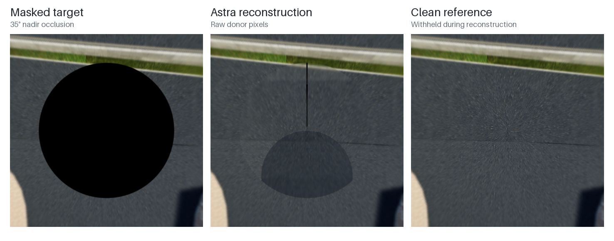
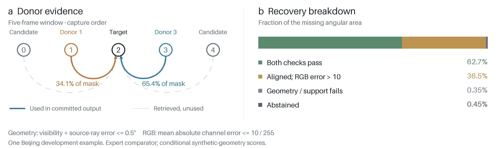
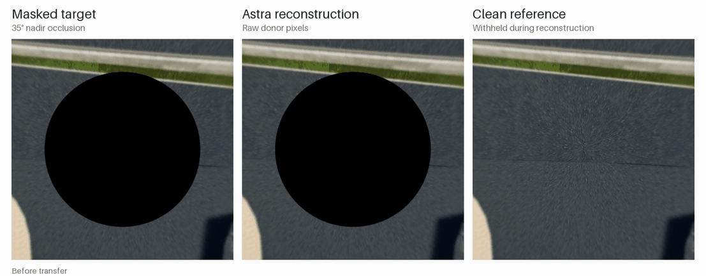

# PAVER
**Panoramic Alignment and View-based Evidence Recovery**

Research on recovering obstructed surfaces in street-level photospheres from
other photographs in the same capture network. A donor must have observed the
surface; unsupported pixels remain missing. This is an early research prototype.



*Controlled nadir repair in PanoCity. Same downward-facing view in all three
panels; source colors and abstentions are preserved.*

## An inspectable reconstruction

This Beijing example is a tool-assisted **GPT-6 Astra expert comparator**, a
separate track from the automated LoFTR pipeline below. It receives the masked
target and four masked neighbors, selects two donors, and commits source-pixel
coordinates before the clean reference is used for scoring. No texture is
generated. The reference was withheld from Astra.



**99.2%** of the missing angular area passes the geometry check; **62.7%** also
passes the RGB-error threshold. The darker donor supplies 34.1% of the mask and
accounts for 86.8% of aligned RGB failures. Surface alignment alone does not
establish faithful appearance.

<details>
<summary>Watch the donor contributions assemble</summary>



Playback reveals the committed pixels in donor-priority order. It is not an
optimization trace. The thin unfilled seam remains an abstention.

</details>

One selected **development** example, not a dataset-wide result. PanoCity is
synthetic and these viewpoints are elevated. Depth consistency supports a
conditional geometric reference; the broader photometric integrity checks
still fail. This comparator is not a proven upper bound or a production model.
[Figure provenance, definitions and reproduction](docs/FIGURES.md) ·
[Measured evidence](docs/figures/beijing/evidence.json).

## What works today

PAVER retrieves nearby panoramas by capture order, distance and time; masks
occluded or unsuitable pixels; finds visible-ground correspondences; jointly
fits camera motion and a shared road plane; and transfers observed donor pixels
only where geometry and support checks pass. It also preserves a homography
control. Current learned matching uses masked LoFTR. This is **local road-plane
geometry, not a general 3D reconstruction of an entire street**.

The metadata graph contains **247 photospheres and 2,843 directed candidate
links**. Query-specific evidence is separate: 968 decisions cover 36 distinct
target/donor pairs across nine reviewed anchors. A graph link is not proof that
one panorama can repair another. Two agreeing donors are not ground truth.

## Current evidence — October 31, 2026

Three contiguous development areas: Gironde rural road (145 spheres), Nantes
large van (51), and Bourges junction/nadir graphic (51). Nine reviewed anchors,
45 reviewed source frames, 108 distinct masks and 216 controlled conditions
cover opaque discs, vehicle-shaped blocks, missing strips, blur, clipping and
JPEG damage, at two severities. Conditions sharing a mask are correlated.
Original Gironde/Alsace hard-road controls remain in every comparison.

The latest solver-budget experiment changed six failed fits from 160 to 640
evaluations, reusing the same observations and all unchanged controls. These
are pooled Gironde **synthetic-patch candidate** results, using the 960-pixel
matching control, not measured accuracy under a real car:

| Obstruction | Coverage before → after | RGB MAE, 0–255, before → after |
|---|---:|---:|
| Opaque disc | 61.64% → 61.64% | 4.85 → 4.85 |
| Vehicle-shaped block | 55.13% → 68.97% | 4.97 → 5.14 |
| Missing strip | 73.77% → 76.29% | 5.01 → 4.98 |

**Not promoted.** The vehicle condition's accepted textured-pixel error tail
above 20 increased from 7.44% to 10.01%. The original hard rear-road control
also worsened on common accepted pixels. Nantes, Bourges and Alsace still
abstain completely. Disc/blur/clipping/JPEG can share the same missing-pixel
geometry, so copying into a blurred patch does not necessarily improve the
damaged input. All failures and controls are retained.

Natural car/rig/logo occlusions have no clean target truth. Their transfer
coverage is **support, not measured correctness**. Controlled patches are
smaller in angular area than the real footprint. None of the repeatedly used
areas is an independent test set. See [latest decision](solver_budget_v1/recovery_decision.json),
[sampling decision](sampling_v1/recovery_decision.json), and
[benchmark limitations](docs/BENCHMARKS.md).

## Repository and data

Code, protocols, annotations, experiment records and decisions are in Git.
The [research snapshot release](https://github.com/amilcodes/paver/releases/tag/research-2026-10-31)
contains images, masks, correspondence caches, numerical evidence and bulk
catalog metadata as separately checksummed archives. Model weights and local
environments are not bundled. The catalog currently contains 353 collections;
the frozen 100-sequence cohort has 25 complete windows, one incomplete, and 74
pending. The 1,000-collection target has **not** been reached.

```sh
git clone https://github.com/amilcodes/paver.git
cd paver
python3 -m venv .venv
. .venv/bin/activate
pip install -r requirements-dev.txt
python -m pytest -q
```

The lightweight unit suite does not run a learned model. Its two small frozen
mask fixtures are included in Git. Two image-replay integration tests explicitly
skip until release images are installed; two learned-model checks are opt-in.
To install the full frozen evidence locally:

```sh
python tools/fetch_assets.py
python tools/verify_snapshot.py
```

The fetcher verifies archive and per-file checksums, resumes complete parts,
rejects unsafe paths, and preserves existing files unless they already match.
Allow approximately 2.4 GB for assets plus the project's 8 GiB free-space
reserve. Public Panoramax imagery retains its original privacy blurring.

For cached-evidence scientific replay, after fetching all assets:

```sh
python tools/replay_solver_audit.py
```

This replays the latest audit without matching or loading model weights. It
writes a new publication audit, leaving historical results untouched. Fresh
learned experiments need the frozen `requirements-matching.txt` environment,
the recorded checkpoint and an actual-model validation certificate. Historical
runners expect the original `workspace/outputs/project` and `workspace/work`
layout for implementation-source verification. Learned inference is MPS-only
in this research snapshot; CPU unit tests do not establish GPU portability.

## Research discipline

- Hidden clean target pixels are scoring-only: never matching, fitting,
  graph selection, donor ranking or confidence tuning.
- Measure coverage jointly with RGB/gradient error, accepted-error tails and
  abstention. Nonconvergence and complete failure remain in the denominator.
- Ground-plane fits exclude buildings, sky, raised surfaces and movers.
- Freeze damage specifications and route-separated evaluation collections
  before tuning. Keep prior splits, sources, models and controls identifiable.
- One heavy job and one download worker; at least 8 GiB free disk and at most
  8 GiB additional image cache. See [policy](autoresearch/policy.json).

Next: better native/perspective ground observations and a defensible transition
to shared 3D surface geometry. Learned panoramic reconstruction is a candidate,
not an implemented or validated component. See [academic context](docs/RELATED_WORK.md).

## Provenance and licensing

The Git history was **reconstructed during publication** from recorded file
modification times on October 31, 2026. Historical author dates are retained;
committer dates identify the import. These are milestone groupings of surviving
file versions, not recovered historical working trees. New publication work is
dated at publication time. See [history](docs/HISTORY.md).

Portable exports remove local machine paths and update dependent artifact
hashes. [The publication ledger](publication/snapshot.jsonl) preserves each
original hash beside its exported hash. Numerical measurements, masks, images
and model/source identities are unchanged; the original local research was
not edited. Read [publication details](publication/README.md).

Original PAVER code: [MIT](LICENSE). Panoramax data and imagery: **Etalab Open
Licence 2.0**. The PanoCity figure crops are **CC BY 4.0**, attributed to
Yijing Guo et al. (2026). Source-specific producers, dates and modifications
are recorded in manifests; see [data attribution](DATA_LICENSE.md). External models and
third-party code retain their own terms. This work is unaffiliated with Google,
Panoramax, IGN and the cited research groups.
